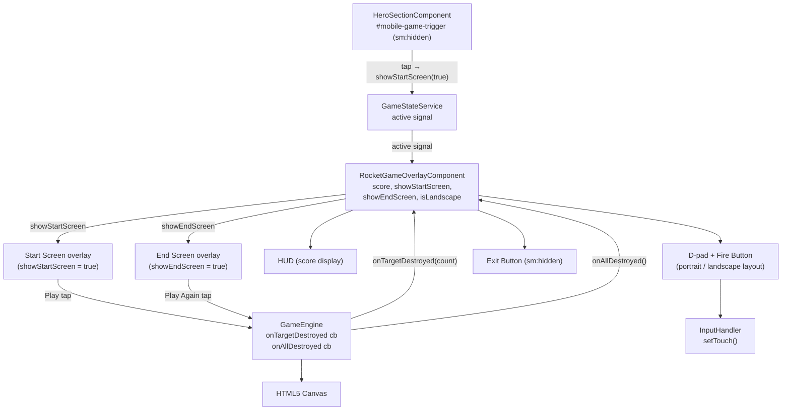
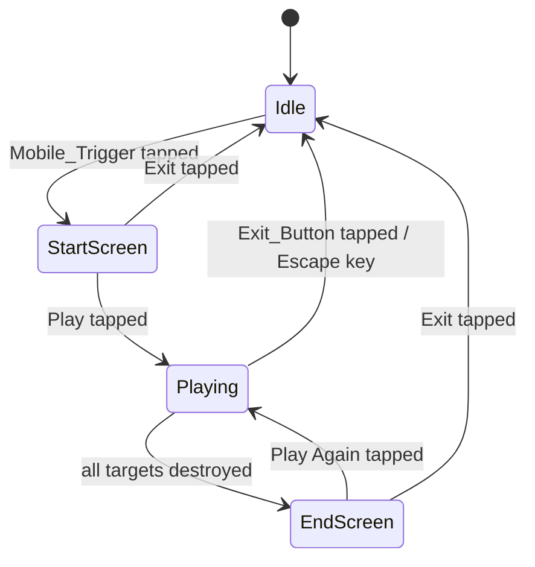

# Design Document: Rocket Game Mobile UX

## Overview

This feature extends the existing `RocketGameOverlayComponent` with a complete mobile UI/UX lifecycle: a touch-friendly trigger to discover and launch the game, a Start Screen with control onboarding, a live score HUD, an End Screen with final score and replay, orientation-aware control layout, and polished touch feedback — all without touching the existing desktop activation flow.

The implementation touches three files:

- **`hero-section.component.ts`** — adds the `Mobile_Trigger` button (hidden on `sm:` and above)
- **`rocket-game-overlay.component.ts`** — adds new signals, Start/End Screen overlays, HUD, Exit Button, and orientation handling
- **`game-engine.ts`** — adds `onTargetDestroyed` and `onAllDestroyed` callbacks so the component can update score and trigger the End Screen

All new code is SSR-safe (guarded with `isPlatformBrowser`) and follows the existing Angular 18 standalone + OnPush + Signals conventions.

---

## Architecture



### State machine



---

## Components and Interfaces

### HeroSectionComponent changes

A single `<button id="mobile-game-trigger">` is added inside the existing flex container, visible only below the `sm` breakpoint (`sm:hidden`). Tapping it calls `GameStateService` to set `active` to `true` and signals the Overlay to show the Start Screen.

Because `GameStateService` currently only holds `active`, a second signal `showStartScreen` is added to `GameStateService` so the hero section can communicate intent to the Overlay without a direct component reference.

**Updated `GameStateService`:**

```typescript
@Injectable({ providedIn: 'root' })
export class GameStateService {
  readonly active        = signal<boolean>(false);
  readonly showStartScreen = signal<boolean>(false);
}
```

The hero section calls:
```typescript
gameState.showStartScreen.set(true);
gameState.active.set(true);
```

### RocketGameOverlayComponent — new signals

```typescript
readonly score           = signal<number>(0);
readonly showStartScreen = this.gameState.showStartScreen; // alias
readonly showEndScreen   = signal<boolean>(false);
readonly isLandscape     = signal<boolean>(false);
```

### RocketGameOverlayComponent — new template regions

All new template regions are wrapped in `@if (active())` and use `sm:hidden` (or `hidden sm:flex`) to restrict to mobile viewports.

| Region | Condition | z-index |
|---|---|---|
| Start Screen | `showStartScreen()` | 10002 |
| End Screen | `showEndScreen()` | 10002 |
| HUD | `active() && !showStartScreen() && !showEndScreen()` | 10001 |
| Exit Button | `active()` | 10001 |
| D-pad + Fire | `active() && !showStartScreen() && !showEndScreen()` | 10000 |

### GameEngine — callback interface

```typescript
export interface GameCallbacks {
  onTargetDestroyed?: (destroyedCount: number) => void;
  onAllDestroyed?: () => void;
}
```

`start()` gains an optional fourth parameter:

```typescript
start(
  ctx: CanvasRenderingContext2D,
  canvas: HTMLCanvasElement,
  inputHandler: InputHandler,
  targetCache: TargetEntry[],
  callbacks?: GameCallbacks
): void
```

Inside the loop, after processing `result.destroyedIndices`:

```typescript
if (result.destroyedIndices.length > 0) {
  this.destroyedCount += result.destroyedIndices.length;
  this.callbacks?.onTargetDestroyed?.(this.destroyedCount);

  const allGone = this.targetCache.every(e => e.destroyed);
  if (allGone) {
    this.stop();
    this.callbacks?.onAllDestroyed?.();
  }
}
```

`destroyedCount` is reset to `0` in `start()`.

---

## Data Models

### Score tracking

`score` is a `signal<number>(0)` on the Overlay. It is updated via the `onTargetDestroyed` callback:

```typescript
private readonly onTargetDestroyed = (count: number): void => {
  this.score.set(count);
};
```

Because `destroyedCount` in the engine is strictly additive (only incremented, never decremented within a session), `score` is monotonically non-decreasing during a session.

### Orientation tracking

`isLandscape` is updated in the existing `onResize` handler (already debounced via RAF):

```typescript
private readonly onResize = (): void => {
  if (this.resizeRafId !== null) return;
  this.resizeRafId = requestAnimationFrame(() => {
    this.resizeRafId = null;
    this.canvasWidth.set(window.innerWidth);
    this.canvasHeight.set(window.innerHeight);
    this.isLandscape.set(window.innerWidth > window.innerHeight);
    refreshRects(this.targetCache);
  });
};
```

`isLandscape` is also set during `activate()` to capture the initial orientation.

### State reset on deactivate

`deactivate()` resets all new signals:

```typescript
private deactivate(): void {
  this.engine.stop();
  this.score.set(0);
  this.gameState.showStartScreen.set(false);
  this.showEndScreen.set(false);
  this.active.set(false);
  // ... existing canvas clear + touch reset
}
```

### Play Again flow

Tapping "Play Again" on the End Screen:
1. Sets `showEndScreen` to `false`
2. Resets `score` to `0`
3. Rebuilds the target cache (restores visibility of destroyed elements)
4. Calls `engine.start()` with fresh callbacks

```typescript
playAgain(): void {
  this.showEndScreen.set(false);
  this.score.set(0);
  // Restore destroyed elements
  for (const entry of this.targetCache) {
    const el = entry.element as HTMLElement;
    el.style.visibility = '';
    el.classList.remove('target-breaking');
    entry.destroyed = false;
  }
  this.targetCache = buildCache();
  this.startEngine();
}
```

### Control layout — portrait vs landscape

The D-pad and Fire Button container uses conditional Tailwind classes driven by `isLandscape()`:

```
Portrait:  bottom-8, gap buttons 52×52 px, fire button 72 px diameter
Landscape: bottom-4, gap buttons 44×44 px, fire button 60 px diameter
```

The layout switch is purely CSS-driven via signal-bound class bindings — no engine restart required.

---

## Correctness Properties

*A property is a characteristic or behavior that should hold true across all valid executions of a system — essentially, a formal statement about what the system should do. Properties serve as the bridge between human-readable specifications and machine-verifiable correctness guarantees.*

### Property 1: Score monotonicity

*For any* sequence of `onTargetDestroyed` callback invocations during a single game session, the `score` signal value SHALL only ever increase or stay the same — it SHALL never decrease.

**Validates: Requirements 5.2**

### Property 2: End Screen trigger

*For any* target cache of arbitrary size, the `showEndScreen` signal SHALL become `true` if and only if every entry in the cache has `destroyed === true` (i.e., the `onAllDestroyed` callback fires exactly when the last target is destroyed).

**Validates: Requirements 4.1**

### Property 3: Start/End Screen gate

*For any* game state where `showStartScreen` OR `showEndScreen` is `true`, the `GameEngine` SHALL NOT be in a running state (i.e., `engine.stop()` has been called and `engine.start()` has not been called since).

**Validates: Requirements 3.5, 4.5**

### Property 4: Orientation signal accuracy

*For any* `(width, height)` pair delivered by a `resize` event, after the RAF callback fires, `isLandscape()` SHALL equal `width > height`.

**Validates: Requirements 9.5, 10.1**

### Property 5: Canvas dimensions match window after resize

*For any* `(width, height)` pair delivered by a `resize` event, after the RAF callback fires, `canvasWidth()` SHALL equal `width` and `canvasHeight()` SHALL equal `height`.

**Validates: Requirements 10.1**

### Property 6: Exit resets all session state

*For any* game session with arbitrary score and screen state, after `deactivate()` is called, `score()` SHALL equal `0`, `showStartScreen()` SHALL equal `false`, and `showEndScreen()` SHALL equal `false`.

**Validates: Requirements 2.2, 4.4**

---

## Error Handling

| Scenario | Handling |
|---|---|
| `isPlatformBrowser` returns false (SSR) | All new signals initialise to safe defaults; no mobile controls rendered; no `window` access |
| `onAllDestroyed` fires but canvas context is gone | `deactivate()` guards canvas clear with null check (existing pattern) |
| "Play Again" called with no remaining targets in DOM | `buildCache()` returns empty array; `onAllDestroyed` fires immediately on next frame; End Screen re-shown |
| Orientation change fires while Start/End Screen is visible | `isLandscape` updates normally; engine is not running so no clamping needed; layout updates via signal binding |
| `GameStateService.showStartScreen` set to `true` while game already active | Overlay checks `active()` before showing Start Screen; duplicate activation is a no-op |
| Touch events fire after `deactivate()` | `inputHandler.setTouch()` calls are harmless when engine is stopped; state is reset on next `activate()` |
| `destroyedCount` callback fires after `engine.stop()` | Callbacks are cleared in `stop()` to prevent stale updates |

---

## Testing Strategy

### Unit Tests (`.spec.ts`) — Jasmine 5 + Karma 6

Focus on specific examples, integration points, and edge cases:

- **`GameStateService`**: verify `showStartScreen` signal initialises to `false`
- **`GameEngine` callbacks**: verify `onTargetDestroyed` called with correct count after each destruction; verify `onAllDestroyed` called exactly once when last target destroyed; verify callbacks not called after `stop()`
- **`RocketGameOverlayComponent`**:
  - `deactivate()` resets `score`, `showStartScreen`, `showEndScreen` to initial values
  - `playAgain()` resets score to 0 and calls `engine.start()`
  - `onResize` handler sets `isLandscape` correctly for portrait and landscape dimensions
  - Start Screen renders when `showStartScreen` is true; hidden when false
  - End Screen renders when `showEndScreen` is true; hidden when false
  - HUD renders when active and neither screen is showing
  - Exit Button has `aria-label="Exit game"`
  - All D-pad buttons have correct `aria-label` values
  - Fire Button has `aria-label="Fire"`
  - SSR: no mobile controls rendered when `isPlatformBrowser` returns false
- **`HeroSectionComponent`**: mobile trigger button present in template with correct `aria-label`

### Property-Based Tests (`.pbt.spec.ts`) — fast-check 4

Each property test runs a minimum of **100 iterations**. Each test is tagged with a comment in the format:

`// Feature: rocket-game-mobile-ux, Property N: <property text>`

| Property | Test description | fast-check arbitraries |
|---|---|---|
| P1: Score monotonicity | Generate a sequence of N destruction events (N ≥ 0); verify score after each event ≥ score before | `fc.array(fc.constant('destroy'), { minLength: 0, maxLength: 50 })` |
| P2: End Screen trigger | Generate a target cache of size N (1–20); destroy targets one by one; verify `showEndScreen` becomes true exactly when the Nth target is destroyed | `fc.integer({ min: 1, max: 20 })` |
| P3: Start/End Screen gate | Generate arbitrary sequences of activate/play/exit/allDestroyed events; verify engine never running while either screen is visible | `fc.array(fc.constantFrom('activate','play','exit','allDestroyed'))` |
| P4: Orientation signal accuracy | Generate arbitrary (width, height) pairs; simulate resize; verify `isLandscape()` equals `width > height` | `fc.record({ width: fc.integer({min:1,max:2000}), height: fc.integer({min:1,max:2000}) })` |
| P5: Canvas dimensions match window | Generate arbitrary (width, height) pairs; simulate resize; verify `canvasWidth()` and `canvasHeight()` match | `fc.record({ width: fc.integer({min:1,max:2000}), height: fc.integer({min:1,max:2000}) })` |
| P6: Exit resets state | Generate arbitrary score values and screen states; call `deactivate()`; verify all signals reset | `fc.record({ score: fc.integer({min:0,max:100}), startScreen: fc.boolean(), endScreen: fc.boolean() })` |

Both unit and property tests are complementary: unit tests catch concrete bugs with known inputs; property tests verify general correctness across the full input space.
